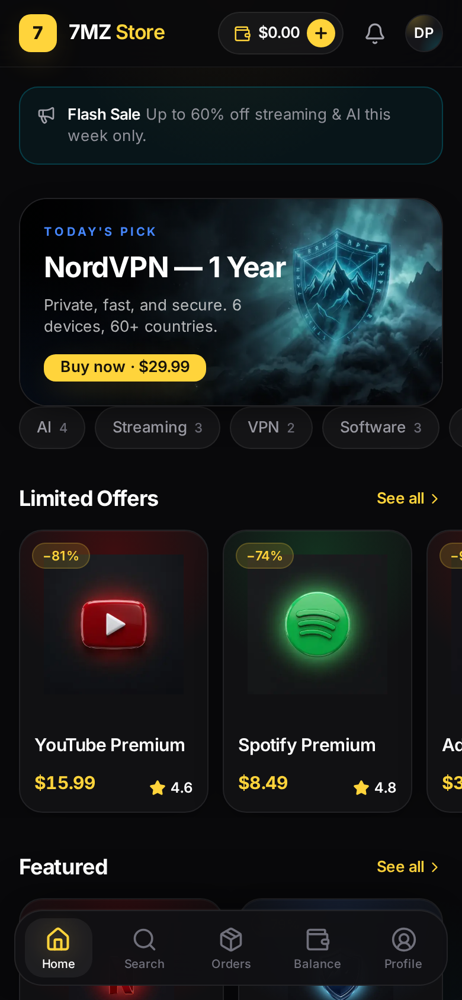

<div align="center">

# 7MZ Store

**Premium digital goods storefront — built as a Telegram Mini App**

Next.js 16 · React 19 · NestJS 11 · PostgreSQL (Prisma 7) · Redis · Tailwind CSS 4 · Framer Motion

*Instant delivery · Multi-provider payments · Referrals & missions · Full admin panel*

</div>

---

## What is this?

7MZ Store is a production-grade e-commerce platform that lives inside Telegram. Customers
browse a dark, glass-morphism storefront, pay with wallet balance, Telegram Stars, crypto,
or cards, and receive their codes / accounts / files **instantly and encrypted at rest**.

**Monorepo layout**

```
7mz-store/
├── apps/
│   ├── miniapp/     # Telegram Mini App — Next.js 16 (Turbopack), Tailwind 4, Framer Motion
│   └── api/         # REST API — NestJS 11, Prisma 7 (PostgreSQL), Redis, JWT auth
├── packages/
│   ├── ui/          # Design system — 14+ components, dark glass tokens
│   ├── shared/      # Shared TypeScript types, Zod schemas, constants
│   └── typescript-config/
├── tools/
│   ├── devstack/    # Local Postgres (embedded) — develop without Docker
│   └── screenshot/  # Playwright visual QA harness
└── docs/            # Deployment guide, go-live plan, QA screenshots
```

## Feature highlights

- **Telegram-native auth** — HMAC-verified `initData`, JWT access + rotating refresh
  tokens with reuse detection (token-theft response), device sessions, TOTP 2FA
- **Catalog** — nested categories, full-text search, 6 sort modes, cursor pagination,
  flash sales, reviews with verified-purchase badges
- **Commerce** — wallet ledger with immutable transactions, coupons & promo codes,
  multi-provider payment adapters (Telegram Stars, crypto, Stripe, PayPal, Binance Pay,
  Coinbase Commerce) with webhook support
- **Instant delivery** — AES-256-GCM-encrypted stock (codes / credentials / files),
  released automatically on payment confirmation
- **Growth** — referral commissions, missions, daily reward streaks, prize wheel
- **Operations** — audit log on every sensitive action, rate limiting, Swagger docs,
  health checks, role-hierarchy RBAC (customer → support → manager → admin → super admin)

## Quick start (local development)

```bash
# Requirements: Node 20+, pnpm 10 (corepack enable)
pnpm install

# 1. Boot local PostgreSQL (embedded — no Docker needed)
node tools/devstack/start.mjs &

# 2. Configure the API
cp apps/api/.env.example apps/api/.env       # then fill in the generated secrets

# 3. Migrate + seed the demo catalog
pnpm db:migrate
pnpm db:seed

# 4. Run everything
pnpm dev          # API on :4000, Mini App on :3000
```

Open http://localhost:3000 — with `NEXT_PUBLIC_DEV_MODE=true` the app runs in a mock
Telegram environment (paired with the API's `AUTH_DEV_BYPASS`) so you can develop in a
plain browser. Production always verifies real Telegram signatures.

API reference: http://localhost:4000/api/docs (Swagger).

## Deployment

The repo is deploy-ready for **Railway** (API + PostgreSQL + Redis via `railway.json` +
`apps/api/Dockerfile`, migrations run automatically on every deploy) and **Vercel**
(Mini App, root directory `apps/miniapp`).

**→ Follow [`docs/DEPLOYMENT.md`](docs/DEPLOYMENT.md)** for the full 10-minute
walkthrough including BotFather setup.

## Screenshots

| Home | 
|---|
|  |

## Security model

- Telegram `initData` verified with the official HMAC algorithm (secret = HMAC("WebAppData", bot token))
- Refresh-token rotation with family revocation on replay (theft detection)
- Secrets at rest (stock content, 2FA secrets) encrypted with AES-256-GCM
- Strict env validation at boot; the API refuses to start misconfigured
- Rate limiting, helmet, strict CORS, immutable audit trail

## License

Proprietary — all rights reserved.
